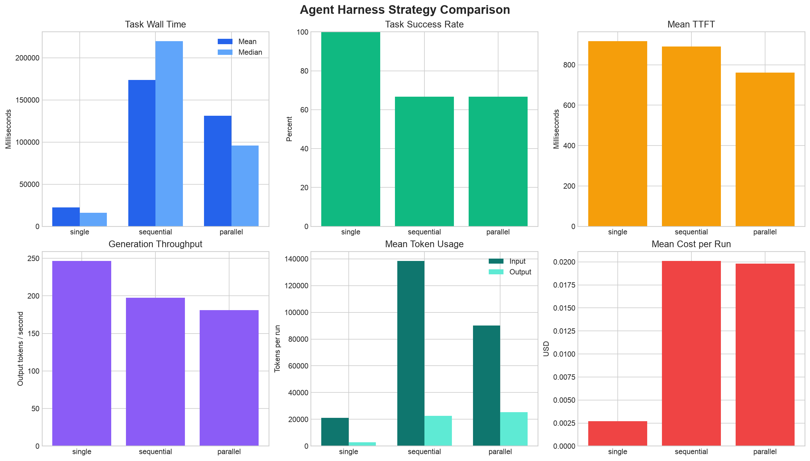
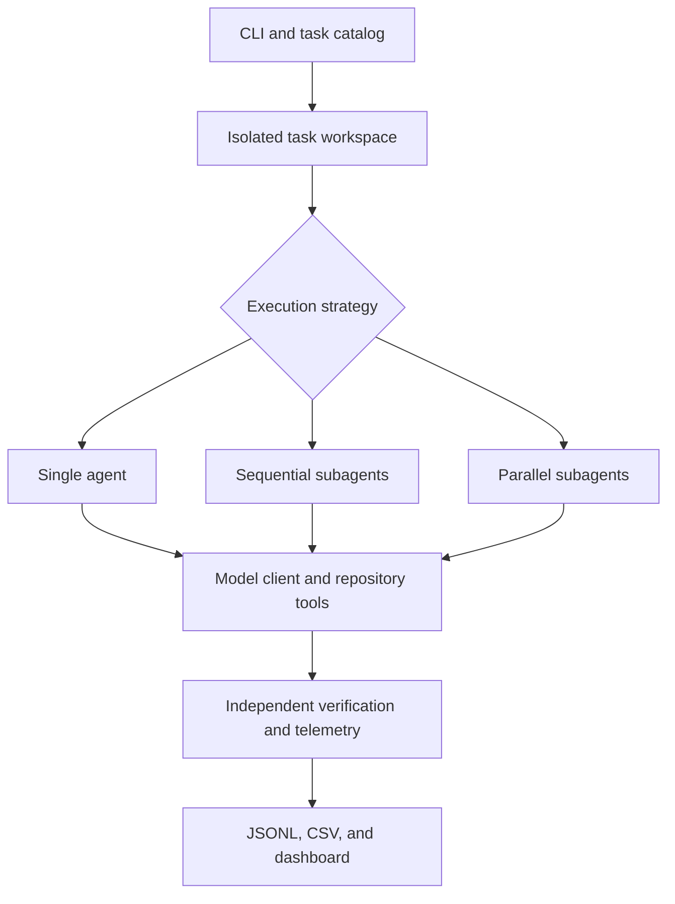

# Agent Harness Bench

[](https://github.com/Gopal3746/agent-harness-bench/actions/workflows/ci.yml)

An instrumented coding-agent harness for studying how orchestration strategies
affect correctness, latency, token usage, tool activity, and inference cost.

Agent Harness Bench runs repository-level software-engineering tasks using
single-agent, sequential-subagent, and parallel-subagent architectures. It
executes each task in an isolated workspace, verifies the result with
task-specific tests, records structured telemetry, and generates comparative
analysis artifacts.

The implementation is covered by 173 automated tests, including agent-loop,
workspace-isolation, merge-conflict, verifier-protection, telemetry, CLI, and
Harbor integration tests.

## Research questions

The project is designed to answer three questions:

1. When does task decomposition improve coding-agent performance?
2. What inference and coordination overhead does each strategy introduce?
3. Does parallel execution reduce end-to-end latency enough to justify its
   additional token usage and cost?

## Corrected pilot result

A corrected 18-run pilot compared three strategies across six coding tasks
using `minimax/minimax-m3.1-flash`. It was run after fixing verifier isolation,
worker context, finalization, partial parallel merging, and telemetry issues
identified during review of the original experiment.



| Strategy | Strict pass rate | Verification rate | Mean wall time | Mean model calls | Cost per run |
| --- | ---: | ---: | ---: | ---: | ---: |
| Single | 100.0% | 100.0% | 22.66 s | 6.83 | $0.00270 |
| Sequential | 66.7% | 100.0% | 173.71 s | 33.67 | $0.02010 |
| Parallel | 66.7% | 66.7% | 131.02 s | 21.50 | $0.01982 |

The corrected pilot passed 14 of 18 strict runs and cost `$0.255740`. Sixteen
of 18 workspaces passed independent repository verification. A strict pass
requires both successful verification and clean agent termination.

The original pilot passed 6 of 18 strict runs. The corrected result is a
44.4-percentage-point improvement, showing that harness behavior was a major
experimental confounder. Both pilots are retained for transparency.

These results remain exploratory. Each task and strategy was run once, so they
should not be interpreted as statistically significant.

## Key findings

### Harness correctness materially changed the conclusion

Worker-scoped verification, parent-task context, a reserved completion turn,
successful-worker merging, and planner-selected file context raised sequential
success from 0.0% to 66.7% and parallel success from 33.3% to 66.7%.

The original near-zero subagent result was therefore not a reliable measure of
the strategies themselves.

### Single-agent execution remained strongest on small tasks

Single-agent execution passed all six tasks and remained the fastest and least
expensive strategy. Sequential and parallel mean cost per run was about 7.45x
and 7.35x the single-agent cost, respectively.

For these small repositories, one agent had enough context to complete the work
without decomposition overhead.

### Parallel improved latency relative to sequential

Parallel and sequential execution each passed four of six strict runs.
Parallel was 24.6% faster on mean wall time and cost 1.4% less, showing a real
latency benefit from concurrent workers when compared with sequential
decomposition.

Parallel still took 5.78x as long as the single-agent baseline and used 4.29x
as many input tokens. Parallelism reduced subagent latency; it did not overcome
the overall orchestration cost on this task set.

### Planning mattered; merging did not dominate

Mean planner time was 11.87 seconds for sequential and 10.16 seconds for
parallel runs. Mean parallel merge time was only 1.54 milliseconds, so file
merging was not responsible for the remaining latency gap.

The larger costs came from additional model calls, worker output, and repeated
tool-driven execution.

### Correctness and termination remain distinct outcomes

Three corrected runs reached the maximum-step condition. Two had already
produced workspaces that passed independent verification, but they failed the
strict metric because the agent did not terminate cleanly.

The harness therefore reports independent verification, completion status,
maximum-step termination, and strict end-to-end success separately.

The full corrected methodology and results are available in
[`experiments/corrected-pilot`](experiments/corrected-pilot/README.md). The
superseded original result remains in
[`experiments/pilot`](experiments/pilot/README.md).

## Architecture



## Execution strategies

### Single agent

One agent receives the complete task, inspects the repository, edits files, and
runs commands until it completes or reaches the configured step limit.

This is the lowest-overhead strategy and serves as the experimental baseline.

### Sequential subagents

A planner decomposes the task into dependency-aware subtasks. Workers execute
those subtasks in topological order so later workers can observe earlier
changes. Planner-selected repository files are preloaded into bounded worker
contexts and refreshed after prerequisite changes.

This strategy tests whether focused contexts improve correctness enough to
offset additional inference calls.

### Parallel subagents

A planner identifies independent subtasks, which run concurrently in cloned
workspaces. The harness calculates file-level change sets and merges compatible
changes into the final workspace. Workers in the same execution group share a
bounded snapshot of planner-selected file context.

Conflicting changes are rejected rather than silently overwritten. Changes
from successful workers are preserved even when another worker in the same
group fails.

## Coding-agent tools

Agents interact with repositories through structured tools:

- list repository files;
- read bounded file ranges;
- search repository text;
- write files;
- replace exact text;
- run allowlisted commands; and
- execute configured tests during single-agent runs.

Repository paths are resolved against the workspace root. Absolute paths,
parent-directory traversal, and symlink escapes are rejected by the file
tools. Native command execution is not a host sandbox: an allowlisted
interpreter can access paths outside the workspace. Use the Harbor integration
when container isolation is required.

## Isolated execution and verification

Every task is provisioned into a fresh workspace. The source repository remains
unchanged, and temporary workspaces are removed unless retention is explicitly
enabled.

After the agent stops, the harness runs the task's verification command
independently. Protected verifier files are restored from an immutable snapshot
before verification, so agent edits cannot weaken the test oracle. Agent claims
are never treated as proof of correctness.

A run is considered a strict pass only when:

1. the agent terminates successfully; and
2. the independent verifier succeeds.

## Telemetry

Each run produces a structured JSONL record containing:

- task, model, strategy, and run identifiers;
- agent status and termination error;
- end-to-end wall time;
- model-call and tool-call counts;
- bounded, redacted tool arguments and responses;
- tool errors and tool execution duration;
- input, output, cached, and reasoning tokens;
- reported inference cost;
- planning and merge phase durations;
- time to first token;
- total model latency;
- output-token throughput;
- stream-event intervals;
- independent verification results.

Stream-event interval is recorded as an ITL-style proxy. It is not guaranteed
to represent exact token-level inter-token latency because providers may stream
multiple tokens in one event.

## Repository structure

```text
agent-harness-bench/
├── .github/
│   └── workflows/
│       └── ci.yml
├── benchmarks/
│   └── tasks/
│       ├── audit-events/
│       ├── config-merge/
│       ├── input-validation/
│       ├── pagination-client/
│       ├── service-retries/
│       └── ttl-cache/
├── experiments/
│   ├── corrected-pilot/
│   │   ├── README.md
│   │   ├── runs.jsonl
│   │   ├── summary.csv
│   │   ├── task-summary.csv
│   │   ├── comparisons.csv
│   │   ├── strategy-dashboard.png
│   │   └── reproduce.sh
│   └── pilot/
│       └── ... original pilot artifacts
├── harbor/
│   ├── README.md
│   └── tasks/
│       └── value-update/
├── src/
│   └── agent_harness/
│       ├── agent/
│       ├── integrations/
│       ├── telemetry/
│       ├── tools/
│       ├── analysis.py
│       ├── benchmark.py
│       ├── cli.py
│       ├── models.py
│       ├── plotting.py
│       ├── runner.py
│       ├── safety.py
│       ├── suite.py
│       ├── task_catalog.py
│       └── workspace.py
└── tests/
```

## Requirements

- Python 3.12 or newer
- An OpenRouter API key for live model experiments
- Docker Desktop for Harbor container evaluation

Unit tests, CLI dry runs, task discovery, analysis, and Harbor schema validation
do not require paid model calls.

## Installation

```bash
git clone https://github.com/Gopal3746/agent-harness-bench.git
cd agent-harness-bench

python3.12 -m venv .venv
source .venv/bin/activate

python -m pip install --upgrade pip
python -m pip install -e ".[dev]"
```

Verify the installation:

```bash
agent-harness --version
agent-harness --help

ruff check .
python -m pytest
```

## Discover benchmark tasks

```bash
agent-harness tasks benchmarks/tasks
```

Each benchmark task contains:

- a natural-language instruction;
- a source repository;
- a reproducible failing baseline;
- an independent verification command;
- task tags describing its structure.

## Plan an experiment without spending money

The `--dry-run` option validates the suite and reports the planned number of
runs without calling a model:

```bash
agent-harness benchmark-suite \
  benchmarks/tasks \
  --model minimax/minimax-m3.1-flash \
  --strategy single \
  --strategy sequential \
  --strategy parallel \
  --repetitions 1 \
  --parallelism 2 \
  --max-steps 9 \
  --max-total-runs 18 \
  --dry-run
```

## Run one task

Set the API key in the environment. Never commit it to the repository.

```bash
read -s "OPENROUTER_API_KEY?OpenRouter API key: "
export OPENROUTER_API_KEY
printf '\n'
```

Run a task with the single-agent strategy:

```bash
agent-harness run \
  benchmarks/tasks/input-validation/task.json \
  --model minimax/minimax-m3.1-flash \
  --strategy single \
  --max-steps 9 \
  --output results/single-run.jsonl \
  --workspace-root workspaces
```

Select another strategy with:

```text
--strategy sequential
--strategy parallel --parallelism 2
```

## Run a controlled suite

```bash
agent-harness benchmark-suite \
  benchmarks/tasks \
  --model minimax/minimax-m3.1-flash \
  --strategy single \
  --strategy sequential \
  --strategy parallel \
  --repetitions 1 \
  --parallelism 2 \
  --max-steps 9 \
  --temperature 0 \
  --seed 42 \
  --suite-id example-suite \
  --max-total-runs 18 \
  --output results/suite-runs.jsonl \
  --workspace-root workspaces
```

The harness refuses experiments that exceed `--max-total-runs`. It also refuses
to append to an existing non-empty output file unless overwrite behavior is
explicitly requested.

## Analyze results

```bash
agent-harness analyze \
  results/suite-runs.jsonl \
  --output results/summary.csv \
  --task-output results/task-summary.csv \
  --comparison-output results/comparisons.csv \
  --baseline single \
  --plot-output results/strategy-dashboard.png
```

The analysis reports:

- pass rate;
- mean and median wall time;
- TTFT;
- output-token throughput;
- model and tool calls;
- input and output tokens;
- total cost;
- mean planning and merge durations;
- baseline-relative speedup and percentage changes;
- per-task strategy results.

## Reproduce the corrected pilot

The reproduction script refuses to overwrite an existing result file:

```bash
read -s "OPENROUTER_API_KEY?OpenRouter API key: "
export OPENROUTER_API_KEY
printf '\n'

./experiments/corrected-pilot/reproduce.sh \
  experiments/reproduction

unset OPENROUTER_API_KEY
```

Because this command performs live inference, reproduced values may differ due
to provider routing, model updates, and network conditions.

## Harbor integration

Install the optional Harbor dependency:

```bash
python -m pip install -e ".[dev,harbor]"
```

Validate the bundled Harbor task with its reference solution:

```bash
harbor run \
  -p harbor/tasks/value-update \
  --agent oracle
```

This reference run does not call a model. A successful result has a reward of
`1.000`.

Run Agent Harness Bench as a Harbor custom agent:

```bash
harbor run \
  -p harbor/tasks/value-update \
  --agent \
  agent_harness.integrations.harbor_agent:AgentHarnessHarborAgent \
  --model minimax/minimax-m3.1-flash \
  --ae OPENROUTER_API_KEY="$OPENROUTER_API_KEY"
```

The adapter uploads the harness into Harbor's isolated task environment,
executes the coding-agent loop, and copies token, cost, latency, tool-use, and
status information into Harbor's agent context. Harbor then runs its independent
verifier.

See [`harbor/README.md`](harbor/README.md) for details.

## Continuous integration

GitHub Actions runs the following checks on pushes and pull requests:

- Python 3.12 installation;
- editable installation with development and Harbor dependencies;
- Ruff linting;
- the complete pytest suite;
- Harbor task-schema validation;
- custom Harbor agent import validation;
- API-free CLI and benchmark dry-run smoke tests.

The workflow does not require an OpenRouter secret.

## Experiment safety

The harness includes safeguards for paid experiments:

- explicit total-run limits;
- dry-run planning;
- refusal to overwrite non-empty outputs;
- isolated task workspaces;
- fixed seeds and temperatures;
- structured cost telemetry;
- API keys read only from environment variables.

Users should still monitor their provider balance during larger experiments.

## Limitations

The current implementation has several known limitations:

- The pilot has one repetition per task and strategy.
- Only one model was evaluated.
- Subagent strategies use the same per-agent step limit as the baseline.
- Parallel merges operate at the file-change level.
- The task suite contains small Python repositories.
- Stream events are only an approximation of token-level ITL.
- Model behavior may change as providers update weights or routing.
- The harness currently uses local process isolation for its native task suite;
  Harbor provides container isolation for framework-based evaluation.

## Next research steps

Future experiments should investigate:

1. multiple repetitions with confidence intervals;
2. separate planner and worker step budgets;
3. decomposition-confidence thresholds;
4. adaptive strategy selection;
5. parallelism levels of 1, 2, 4, and 8;
6. larger repository tasks;
7. multiple models and inference providers;
8. conflict-aware semantic merge strategies;
9. token-level streaming telemetry where providers expose it.

The corrected pilot shows that harness details can dominate orchestration
results. After those confounders were addressed, subagent success improved
substantially, but single-agent execution still performed best on this small
task suite. Orchestration should be selected based on task structure rather
than enabled by default.
