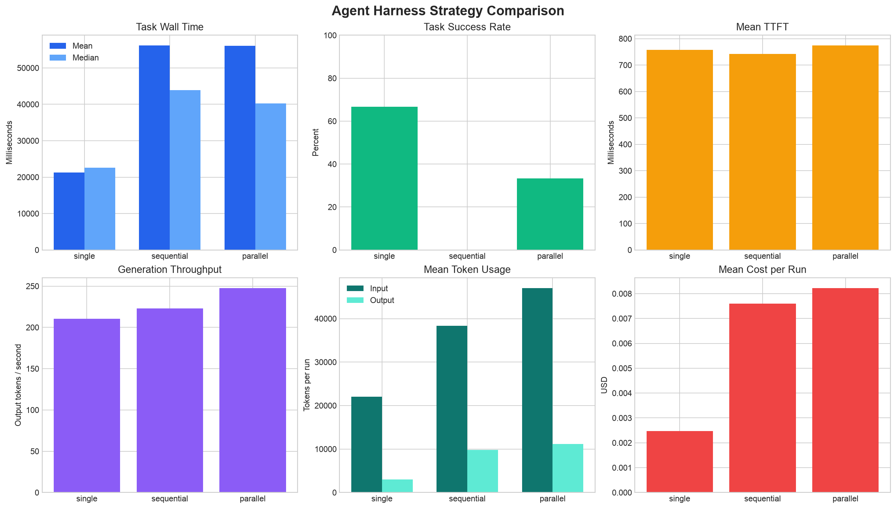

# Pilot orchestration experiment

This experiment compares single-agent, sequential-subagent, and
parallel-subagent execution across six repository-level coding tasks.

The pilot is intentionally small. Its purpose is to validate the benchmark
workflow, measure orchestration overhead, and identify improvements for a
larger controlled study.

## Configuration

| Setting | Value |
| --- | --- |
| Date | November 3, 2026 |
| Model | `minimax/minimax-m3.1-flash` |
| Tasks | 6 |
| Strategies | single, sequential, parallel |
| Repetitions | 1 |
| Total runs | 18 |
| Maximum model steps | 8 per agent |
| Parallelism | 2 |
| Temperature | 0 |
| Seed | 42 |
| Full-suite API cost | $0.109798 |
| Preflight API cost | $0.000867 |

The task suite includes decomposable, tightly coupled, stateful, and
single-module workloads:

- `audit-events`
- `config-merge`
- `input-validation`
- `pagination-client`
- `service-retries`
- `ttl-cache-expiration`

## Aggregate results

A strict pass requires both successful independent verification and clean agent
completion.

| Strategy | Strict passes | Verification passes | Max-step runs | Mean wall time | Mean model calls | Mean tool calls | Cost per run |
| --- | ---: | ---: | ---: | ---: | ---: | ---: | ---: |
| Single | 4/6 | 6/6 | 2/6 | 21.27 s | 7.00 | 12.50 | $0.00247 |
| Sequential | 0/6 | 2/6 | 6/6 | 56.16 s | 12.67 | 18.50 | $0.00760 |
| Parallel | 2/6 | 3/6 | 4/6 | 56.10 s | 15.83 | 23.83 | $0.00822 |

Across all strategies, 6 of 18 runs passed the strict end-to-end metric, while
11 of 18 runs passed independent verification. Five runs therefore produced
correct repository changes but did not terminate cleanly within the eight-step
budget.

## Workload measurements

| Strategy | Mean TTFT | Output throughput | Mean input tokens | Mean output tokens | Total cost |
| --- | ---: | ---: | ---: | ---: | ---: |
| Single | 757.68 ms | 210.55 tok/s | 22,066 | 3,034 | $0.01485 |
| Sequential | 741.84 ms | 222.80 tok/s | 38,330 | 9,797 | $0.04561 |
| Parallel | 774.10 ms | 247.64 tok/s | 47,021 | 11,160 | $0.04934 |

TTFT remained similar across the three strategies. The higher end-to-end
latency of sequential and parallel execution was therefore driven primarily by
additional model calls, tool calls, and generated tokens rather than slower
individual model responses.

## Baseline-relative results

Compared with the single-agent baseline:

- Sequential execution increased mean wall time by 164.0%.
- Parallel execution increased mean wall time by 163.7%.
- Sequential execution increased mean input tokens by 73.7%.
- Parallel execution increased mean input tokens by 113.1%.
- Sequential execution increased cost per run by 207.2%.
- Parallel execution increased cost per run by 232.4%.
- Parallel execution achieved a higher output-token throughput, but the
  additional calls eliminated any end-to-end latency benefit.

## Findings

### Single-agent execution was strongest for this suite

The single-agent strategy passed independent verification on all six tasks. Its
strict pass rate was lower because two agents reached the step limit after
already producing correct code.

For these small repository tasks, a single agent had enough context to make the
required changes without decomposition or merge overhead.

### Parallel execution did not automatically improve latency

Parallel execution passed verification on three tasks and completed cleanly on
two. It used more model calls, tool calls, and tokens than the single-agent
baseline.

The result suggests that parallel execution should be selected only when the
planner identifies genuinely independent work with enough complexity to
justify orchestration overhead.

### Sequential subagents were constrained by the step budget

Every sequential run reached the maximum-step condition. Two still produced
correct changes, but none satisfied the strict completion metric.

This indicates that a shared fixed step limit is not directly comparable across
architectures. Subagent strategies need explicit planner, worker, and
termination budgets.

### Correctness and termination need separate metrics

Five runs passed repository verification but failed the strict metric because
the agent reached its step limit. Reporting only one pass rate would hide this
distinction.

Future analysis should report at least:

- independent verification success;
- clean agent completion;
- maximum-step termination;
- strict end-to-end success.

## Product decisions from the pilot

The pilot leads to four concrete harness improvements:

1. Keep single-agent execution as the default for small or tightly coupled
   tasks.
2. Gate parallel execution on decomposition confidence and independent file or
   module boundaries.
3. Give planner and worker agents separate step budgets.
4. Report code correctness separately from orchestration termination status.

## Limitations

- Each task and strategy was run only once.
- Results are specific to one model and one provider-routing period.
- The suite contains six small Python tasks rather than large production
  repositories.
- The eight-step budget disproportionately constrained subagent strategies.
- Network conditions and provider selection may affect latency and throughput.
- These results are exploratory and should not be treated as statistically
  significant.

A larger study should use multiple repetitions, at least one additional model,
and separate step budgets for each orchestration architecture.

## Artifacts

- `preflight.jsonl` — one-run API and tool-calling validation
- `runs.jsonl` — raw records for the 18-run experiment
- `summary.csv` — aggregate metrics by strategy
- `task-summary.csv` — per-task metrics by strategy
- `comparisons.csv` — changes relative to the single-agent baseline
- `strategy-dashboard.png` — generated strategy comparison dashboard
- `reproduce.sh` — guarded experiment reproduction script
